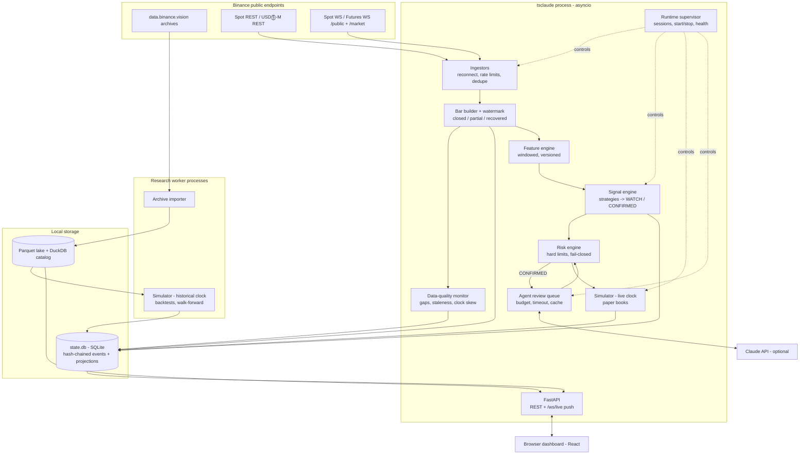

# Architecture

Status: **proposed** (2026-10-19). Decisions are recorded in [`adr/`](adr/).

## 1. Design principles

1. **One code path for research and live.** The same feature functions, signal rules and
   simulator run in backtest, replay and live paper trading. Divergence between them is the most
   common way trading systems lie to their owners, so parity is enforced by tests, not by discipline.
2. **Events are the source of truth.** Everything that happens at runtime (bar closed, gap detected,
   signal transitioned, agent reviewed, order filled) is an append-only, hash-chained event.
   Tables the UI reads are projections that can be rebuilt.
3. **Provenance on every value.** A number shown to the user always carries where it came from
   (live, replay, backtest, simulated, estimated, demo) and whether it is fresh.
4. **Deterministic core, advisory AI.** The LLM layer can only veto or downgrade a signal and is
   measured against the baseline it filters. The app is complete with AI switched off.
5. **Fail closed.** Missing data, stale data, unknown state or an exception in risk evaluation
   blocks new entries. It never defaults to "trade".
6. **Small, verifiable increments.** The app is runnable at the end of every milestone.

## 2. Architectural options considered

| Concern | Options | Choice | Why |
|---|---|---|---|
| Process model | (a) microservices + message broker; (b) multiple local processes + IPC; (c) **single asyncio process + subprocess pool for heavy research** | (c) | One thing to start and stop on Windows; no broker to install; CPU-heavy backtests isolated in worker processes so ingestion never stalls. [ADR-0002](adr/0002-single-process-runtime.md) |
| Operational storage | Postgres / TimescaleDB, DuckDB-only, **SQLite (WAL)** | SQLite | Zero-install, crash-safe small transactional writes, excellent for an append-only event log. [ADR-0003](adr/0003-storage.md) |
| Analytical storage | CSV, a time-series DB, **Parquet + DuckDB** | Parquet + DuckDB | Columnar, compressed, reproducible files with content hashes; DuckDB queries them in place. [ADR-0003](adr/0003-storage.md) |
| Base resolution | Native klines per timeframe, **1-minute canonical bars, higher TFs derived** | 1m canonical | One source of truth; intrabar SL/TP resolution for 5m/15m/1h strategies; consistency check against native klines. [ADR-0004](adr/0004-canonical-1m-bars.md) |
| Simulation | Vectorized backtester + separate paper engine; **one event-driven simulator driven by two clocks** | One simulator | Backtest/paper parity by construction; replaying a recorded live session must reproduce the paper ledger exactly. [ADR-0005](adr/0005-one-simulator-two-clocks.md) |
| Features | Incremental streaming indicators; **pure windowed functions recomputed per bar close** | Windowed functions | Same function vectorized over history and over a trailing window live; a parity test proves equality. [ADR-0006](adr/0006-windowed-feature-parity.md) |
| UI | Streamlit, Dash, NiceGUI, **FastAPI + React/TypeScript static bundle** | FastAPI + React | Real-time push, professional UX, typed API contract; end user needs only Python at runtime because the built bundle ships in the package. [ADR-0008](adr/0008-frontend-stack.md) |
| AI role | Agents decide; agents vote; **agents advise, deterministic gate decides** | Advise-only | Reproducibility, safety, measurable value. [ADR-0007](adr/0007-advisory-agents.md) |

## 3. Component view



### Responsibilities

| Component | Responsibility | Never does |
|---|---|---|
| Runtime supervisor | Owns the session lifecycle; starts/stops tasks; records `session_started/stopped/crashed`; exposes real state to the UI. | Pretend monitoring continues while stopped. |
| Ingestors | One per (market, connection group). Spot WS, Futures `/public` (bookTicker) and `/market` (klines, markPrice) connections; REST for backfill/recovery; weight-aware rate limiter. | Write bars directly to features — they go through the bar builder. |
| Bar builder | Turns kline events into **closed** canonical 1m bars once Binance marks them closed, or recovers them via REST after a watermark deadline; derives 5m/15m/1h/4h. Tags each bar with `source`. | Emit partial bars as closed. |
| Data-quality monitor | Freshness per stream, gap detection & repair queue, duplicate counts, server-clock offset, coverage intervals. | Hide a gap. Unrecoverable gaps stay visible forever. |
| Feature engine | Pure functions over closed bars; versioned; recomputed over a trailing window at each bar close. | Read anything after the decision timestamp. |
| Signal engine | Runs frozen strategy versions; emits `WATCH` and `CONFIRMED` candidates with full context. | Size positions or bypass risk. |
| Risk engine | Deterministic gate; fail-closed; final say before and after agent review. | Accept free-text instructions. |
| Agent review queue | Builds evidence packets, calls Claude (if enabled and within budget), validates JSON, caches by packet hash. | Change entry/SL/TP upward or approve a risk-blocked signal. |
| Simulator | Order/fill/ledger engine shared by backtest and paper; maintains separate books (baseline vs agent-gated). | Know whether its clock is historical or live beyond the clock interface. |
| API | Read models, commands (start/stop, run backtest, settings), live push. Localhost only. | Expose itself on the network. |

## 4. Runtime model

- `tsclaude app` (or the Windows launcher `TradingSystemClaude.cmd`) starts one Python process,
  serves the dashboard on `http://127.0.0.1:<port>` and opens the browser. Monitoring is a separate,
  explicit **Start/Stop** inside the app, so "the server is up" and "we are observing the market"
  are different, visible states.
- Closing the app (Stop → Quit, tray, or Ctrl+C) performs a graceful shutdown: stop new entries,
  close sockets, flush events, record `session_stopped`. A hard kill is detected on next start as
  `session_crashed` and the unobserved interval is recorded.
- On start: integrity check of the event chain → rebuild projections if needed → REST backfill of
  missing closed bars (tagged `rest_recovered`) → resolve open paper positions over the backfilled
  path (tagged `resolved_from_backfill`) → resume live streams. **No signal is ever created for a
  timestamp outside an observed session**; backfilled periods can only be replayed, and replayed
  signals are labeled `REPLAY`.
- Backtests and archive imports run in a `ProcessPoolExecutor`; progress is streamed to the UI.

## 5. Technology stack

| Layer | Choice | Notes |
|---|---|---|
| Language | Python 3.13 (pinned via `uv`) | Windows wheels available for all core deps. |
| Env / packaging | `uv`, `pyproject.toml`, `uv.lock` | One-command setup on Windows. |
| Async I/O | `asyncio`, `websockets`, `httpx` | Windows Proactor event loop tested in CI. |
| Data | Polars, NumPy, PyArrow, DuckDB | Polars for features; DuckDB for analytics over Parquet. |
| Operational DB | SQLite (WAL) via `sqlite3` + thin repository layer | No ORM magic in the event log. |
| Contracts | Pydantic v2 → JSON Schema / OpenAPI | Frontend types generated from OpenAPI. |
| Stats | SciPy, statsmodels (selectively) | Block bootstrap, deflated Sharpe implemented and tested in-house. |
| API | FastAPI + Uvicorn, WebSocket push | Bound to 127.0.0.1, per-launch token, Origin check. |
| Frontend | React + TypeScript (strict) + Vite, TanStack Query/Router, Tailwind + Radix primitives | Built bundle served by FastAPI. |
| Charts | TradingView *lightweight-charts* (Apache-2.0, attribution required) for price; Apache ECharts for analytics | |
| AI | Anthropic Python SDK, structured outputs, prompt caching | Optional at runtime. |
| Quality | pytest, hypothesis, ruff, mypy (strict on core), vitest, Playwright (E2E) | CI: GitHub Actions, Windows + Ubuntu. |

## 6. Repository layout (proposed)

```
trading-system-claude/
  CLAUDE.md                     # conventions for every Claude agent working here
  .claude/agents/               # development subagent definitions
  pyproject.toml  uv.lock  .env.example
  configs/                      # universe, costs, risk, strategies (versioned YAML)
  preregistrations/             # frozen hypothesis files (hashed, never edited after freeze)
  src/tsclaude/
    contracts/                  # pydantic models: events, signals, packets, exports
    runtime/                    # supervisor, sessions, settings, logging
    marketdata/                 # binance clients, ingestors, bar builder, archive importer
    quality/                    # gaps, staleness, clock, coverage
    store/                      # sqlite event store + projections, parquet lake, duckdb catalog
    features/                   # windowed feature functions + registry
    strategies/                 # strategy implementations (versioned)
    signals/                    # lifecycle state machine
    risk/                       # hard limits, kill switch
    sim/                        # orders, fills, ledger, books, clocks
    research/                   # walk-forward, holdout guard, statistics, reports
    agents/                     # evidence packets, prompts, claude client, synthesis rules
    evaluation/                 # metrics, A/B export
    api/                        # fastapi app, read models, ws push
    web/static/                 # built frontend bundle (CI artifact)
  frontend/                     # React/TS source
  tests/{unit,property,integration,parity,e2e,fixtures}/
  scripts/                      # windows launcher, dev helpers
  docs/                         # plans, ADRs, reviews, devlog, evidence
  data/  runs/  logs/           # git-ignored local state
```

## 7. Security and safety

- No exchange API keys anywhere; public endpoints only. A CI check fails if code references
  signed/private Binance endpoints or order placement paths.
- Optional `ANTHROPIC_API_KEY` lives in `.env` (git-ignored); never logged; never sent to the UI.
- API binds to `127.0.0.1` only; mutating requests require the per-launch token embedded in the
  served page and a matching `Origin`, so other web pages in the browser cannot drive the app.
- Agent inputs contain market data only — no personal data, paths or secrets.
- Kill switch: one action stops all new entries and flattens paper books; recorded as an event.
