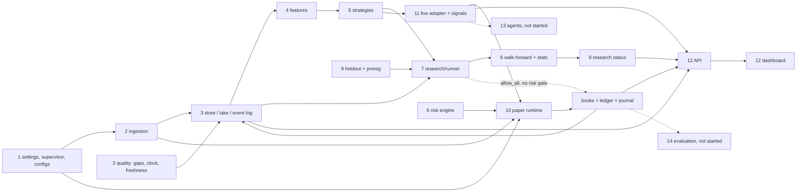

# MVP semantic map

**Date:** 2026-11-10 · **Branch:** `task/mvp-integration` · **Scope:** the 15 MVP components, with source paths, key symbols, evidence and state.

This is a navigation aid, not a source of truth. It uses plain `grep`-verified names and links to the real documents. No vector database and no Graphify (rejected for the MVP, [MVP_LIMITATIONS](MVP_LIMITATIONS.md) "Not adopted").

**How to keep it current**
- When you add, rename or delete a key symbol, update its row in the same commit. Check with `grep -n "^class NAME\|^def NAME" <file>`.
- Update a state only with a linked evidence item (CLAUDE.md rule 5). `ACCEPTED` only where [DECISIONS_PENDING](DECISIONS_PENDING.md) records an owner decision.
- Do not copy CI numbers here. Quote them from [MVP_VALIDATION_REPORT](MVP_VALIDATION_REPORT.md) §2 and §12.
- Status words: IMPLEMENTED (code, no test evidence) · TESTED (automated tests pass in CI) · VERIFIED (also exercised on real data or a real session) · ACCEPTED (owner decision) · BLOCKED · NOT STARTED.

**Where to start reading:** [PLAN_OVERVIEW](PLAN_OVERVIEW.md), [ARCHITECTURE](ARCHITECTURE.md), [MVP_VALIDATION_REPORT](MVP_VALIDATION_REPORT.md) §10, [MVP_CLOSURE_HANDOFF](MVP_CLOSURE_HANDOFF.md) §7.

Overall status (validation report §10, §12): **MVP FUNCTIONAL, VALIDATION INCOMPLETE.** No validated strategy. M3 is not formally accepted (proposal D-A is open). M2 is accepted with limited scope (D-22). M4 infrastructure exists with no real-data run.

## Summary table

| # | Component | State |
|---|---|---|
| 1 | Architecture and configuration | TESTED |
| 2 | Market-data ingestion | VERIFIED |
| 3 | Canonical data and provenance | ACCEPTED (limited, D-22) |
| 4 | Feature engineering | TESTED |
| 5 | Strategy interfaces | TESTED |
| 6 | Risk engine | TESTED |
| 7 | Backtesting and research | VERIFIED |
| 8 | Walk-forward and statistical validation | TESTED |
| 9 | Holdout guard and preregistration | TESTED |
| 10 | Paper-runtime execution | VERIFIED |
| 11 | Signal generation and promotion | TESTED |
| 12 | Dashboard and APIs | TESTED |
| 13 | AI agent integration (M5) | TESTED (mock part only; not wired into the runtime) |
| 14 | Evaluation and export (M6) | TESTED (locally and in CI from `45cf45a`; no real session exported) |
| 15 | Logging, tests, CI, recovery | VERIFIED |

## 1. Architecture and configuration
- **Paths:** [settings.py](../src/tsclaude/runtime/settings.py), [supervisor.py](../src/tsclaude/runtime/supervisor.py), [sessions.py](../src/tsclaude/runtime/sessions.py), [cli.py](../src/tsclaude/cli.py), [configs/](../configs/) (`paper.yaml`, `risk.yaml`, `backtest.yaml`, `ingest_dev.yaml`, `universe*.yaml`, `data_quality.yaml`, `exchange_interruptions.yaml`).
- **Key symbols:** `Settings`; `MonitoringSupervisor` (start/stop, `attach_paper`, `ingestion_status`); `default_service_factory`; `SessionManager` and `observation_intervals`; `build_parser` / `main` in cli.py (`verify-chain`, `verify-replay`, app launch).
- **Depends on:** `marketdata`, `store/eventstore`, `runtime/paper_runtime`. **Consumed by:** `api/server.py` (`run`), the launchers in [scripts/](../scripts/).
- **Requirements / ADRs:** REQ-RT-01..04, NFR-05; [ADR-0002](adr/0002-single-process-runtime.md) (single process), [ADR-0003](adr/0003-storage.md).
- **Tests:** [test_sessions.py](../tests/unit/test_sessions.py), [test_runtime_misc.py](../tests/unit/test_runtime_misc.py), [test_server_lifecycle.py](../tests/integration/test_server_lifecycle.py).
- **Evidence:** validation report §3 (owner production profile, Stage B) and §7 (safe stop).
- **Limits:** 1 s clock-offset block (limitations "Clock sensitivity"); Start is bounded by D-23 (history on demand).
- **State:** TESTED. Config and lifecycle are covered by CI and exercised on the owner PC, but there is no separate acceptance record.
- **Next dependency:** none blocking; owner dashboard smoke check A6.

## 2. Market-data ingestion
- **Paths:** [marketdata/](../src/tsclaude/marketdata/) with `binance/` (REST, WebSocket, limits, parse) and `archive/` (history importer).
- **Key symbols:** `MarketDataService` and `Subscription` (service.py); `IngestionCoordinator` (ingest.py); `Backfiller` (backfill.py); `BarWriter` (single writer thread, writer.py); `Importer` (archive/importer.py); `plan` (ingest_plan.py); `select_universe` (universe.py).
- **Depends on:** `contracts`, `store/livebars`, `quality`. **Consumed by:** `runtime/supervisor`, `features/bars`, `sim/paper`, the data CLI ([datacli.py](../src/tsclaude/marketdata/datacli.py)).
- **Requirements / ADRs:** REQ-DATA-01..08; [ADR-0004](adr/0004-canonical-1m-bars.md), [ADR-0013](adr/0013-exchange-wide-interruptions.md), [ADR-0014](adr/0014-zero-volume-candles.md).
- **Tests:** [tests/unit/marketdata/](../tests/unit/marketdata/) (including `test_quant_equivalence_gate.py`), [tests/unit/archive/](../tests/unit/archive/), [tests/integration/marketdata/](../tests/integration/marketdata/).
- **Evidence:** [RUNBOOK_INGESTION](RUNBOOK_INGESTION.md), [devlog 2026-11-09](devlog/2026-11-09-start-stability-bounded-ingestion.md), ROADMAP live status (owner dev-profile validation, owner-reported). Real sessions in validation report §3, §7.
- **Limits:** production-profile stability is not proven; USD-M history and funding not imported; Top-10 coverage incomplete (limitations "Data scope"); M1 2-hour gate not formally accepted.
- **State:** VERIFIED for the dev profile and the real sessions. M1 is not formally accepted.
- **Next dependency:** USD-M and funding import only if a hypothesis needs it (H4); D-F2 for 2026 data.

## 3. Canonical data and provenance
- **Paths:** [store/](../src/tsclaude/store/) (`eventstore.py`, `lake*.py`, `livebars.py`, `parquet_codec.py`), [quality/](../src/tsclaude/quality/), [contracts/](../src/tsclaude/contracts/) (Lead-owned).
- **Key symbols:** `EventStore` (hash-chained log); `chain_hash`, `Event`, `EventType` (contracts/events.py); `Provenance` and `Sourced[T]` (contracts/provenance.py); `Bar`, `BarSource` (contracts/market.py); `LakeReader`, `LakeWriter`, `dataset_id_of`, `content_hash` (store/lake*.py); `LiveBarStore`; `GapRegistry`, `InterruptionRegistry`, `ClockMonitor`, `FreshnessMonitor` (quality/).
- **Depends on:** nothing above it. **Consumed by:** everything.
- **Requirements / ADRs:** REQ-DATA-04, REQ-UI-02, NFR-07; [ADR-0003](adr/0003-storage.md), [ADR-0010](adr/0010-provenance-typed-values.md), [ADR-0011](adr/0011-hash-chained-event-log.md), [ADR-0013](adr/0013-exchange-wide-interruptions.md), [ADR-0014](adr/0014-zero-volume-candles.md), [ADR-0015](adr/0015-qa-explained-open-difference.md).
- **Tests:** [test_eventstore.py](../tests/unit/test_eventstore.py), [test_contracts.py](../tests/unit/test_contracts.py), [test_chain_properties.py](../tests/property/test_chain_properties.py), `test_md_gaps.py`, `test_md_livebars.py`, [tests/unit/archive/](../tests/unit/archive/).
- **Evidence:** [M2_ACCEPTANCE_RECORD](M2_ACCEPTANCE_RECORD.md), [M2_CLOSURE_CHECKLIST](M2_CLOSURE_CHECKLIST.md), [M2_DATASET_ACCEPTANCE](M2_DATASET_ACCEPTANCE.md), D-17 [devlog](devlog/2026-11-06-m2-d17-canonical-promotion.md).
- **Limits:** SOLUSDT gap 2023-02-14 16:39 (C-2) is a genuine source gap; B01-B12 formal acceptance deferred (D-15); composite manifests carry stale inherited `gaps` metadata, so pin the new composite ids explicitly (D-17); 2023-03-24 halt kept as a registered interruption (D-10).
- **State:** ACCEPTED, limited to Spot 1m for 5 symbols, 2022-01-01 to 2025-12-31, commit `9f908d9` (D-22). Nothing beyond that scope.
- **Next dependency:** D-F2 (2026 holdout months as data), D-G (commit lock files).

## 4. Feature engineering
- **Paths:** [features/core.py](../src/tsclaude/features/core.py), [features/bars.py](../src/tsclaude/features/bars.py).
- **Key symbols:** `BarArrays`, `Feature`; `atr`, `atr_percentile_rank`, `range_high`, `range_low`, `ema`, `ema_warmup`, `volume_zscore`, `realized_vol`; `atr_feature` and siblings (feature factories); `derive_bars`, `BarAggregator` (1m to 5m/15m/1h).
- **Depends on:** `contracts`. **Consumed by:** `strategies/bracket_reference`, `research/feasibility`.
- **Requirements / ADRs:** REQ-BT-03; [ADR-0006](adr/0006-windowed-feature-parity.md) (windowed pure functions with a parity test), [ADR-0004](adr/0004-canonical-1m-bars.md).
- **Tests:** [test_feat_parity_canaries.py](../tests/unit/features/test_feat_parity_canaries.py); aggregation also in `test_md_bars.py`.
- **Evidence:** CI per validation report §2; parity canaries run in every CI.
- **Limits:** only the features the reference strategy needs exist; no indicator cache (D-23 F deferred).
- **State:** TESTED. Used live by the reference strategy warm-up (validation report §3, Stage C).
- **Next dependency:** H1 features, after the owner freezes a preregistration (handoff §5, B5).

## 5. Strategy interfaces
- **Paths:** [strategies/](../src/tsclaude/strategies/) (`base.py`, `bracket_reference.py`, `h1_compression_breakout.py`, `__init__.py`).
- **Key symbols:** `Strategy[P]` (abstract `warmup_bars`, `on_bar`; optional `diagnose`); `Proposal`; `PlanningCosts`; `BracketReference`, `BracketReferenceParams`, `bracket_geometry`; `build_strategy` and `REGISTRY` (unknown ids fail closed); `DRAFT_REGISTRY` and `build_draft_strategy` (the draft `h1_compression_breakout`, usable only by the P&L-free feasibility count; no run or trial possible).
- **Depends on:** `features`, `contracts`. **Consumed by:** `research/runner` (via `research/source.py`), `strategies/live_adapter`.
- **Requirements / ADRs:** REQ-SIG-01, REQ-SIG-05; [ADR-0012](adr/0012-win-rate-margin-objective.md); D-14 (grade X is reference-only).
- **Tests:** [tests/unit/strategies/](../tests/unit/strategies/) (`test_strat_bracket_reference.py`, `test_strat_diagnose.py`).
- **Evidence:** [devlog 2026-10-28 reference adapter](devlog/2026-10-28-mvp3-reference-adapter.md).
- **Limits:** `bracket_reference` is the only runnable strategy, a pipeline reference, not a research subject (D-14); it traded 0 times on real BTC 2024-Q1 with defaults. H1 exists only as a DRAFT (no runs); H2-H4 not implemented. Every ADR-0012 take-profit geometry, and every H1-v2 configuration, is incompatible with the live risk floor 1.5 (`research/live_compat.py`, D-E); the H1-v3 draft (2, 2.5, 3 R) is compatible.
- **State:** TESTED.
- **Next dependency:** owner freeze of [H1-v3](research/H1-v3.preregistration.DRAFT.yaml) after the feasibility count and D-C, D-E, D-F1 ([H1 decision package](research/H1_DECISION_PACKAGE.md)).

## 6. Risk engine
- **Paths:** [risk/](../src/tsclaude/risk/) (`engine.py`, `config.py`, `market.py`, `hook.py`), [configs/risk.yaml](../configs/risk.yaml).
- **Key symbols:** `RiskEngine.evaluate` (returns `RiskVerdict`); rule functions `rule_data_freshness`, `rule_clock_skew`, `rule_spread`, `rule_reward_risk`, `rule_risk_per_trade`; `cost_adjusted_rr`; `RiskConfig`, `load_risk_config`; `MarketStateTracker`, `MarketView`; `EngineRiskHook`.
- **Depends on:** `sim/book` types (`RiskCheck`, `RiskDecision`). **Consumed by:** `Book` (via the hook) in the paper runtime; backtests use `allow_all` instead.
- **Requirements / ADRs:** REQ-RISK-01, REQ-RISK-02, REQ-PT-04; [ADR-0007](adr/0007-advisory-agents.md) (agents cannot bypass risk).
- **Tests:** [tests/unit/risk/](../tests/unit/risk/) (`test_risk_rules.py` covers an exception in a rule; `test_risk_book_integration.py`).
- **Evidence:** M3 fault-injection tests cited in D-A; validation report §10 ("risk fail-closed (tests)").
- **Limits:** backtests apply no risk gate; the live baseline book requires net reward/risk >= 1.5 and would reject every geometry ADR-0012 needs (handoff I-1; D-E open).
- **State:** TESTED.
- **Next dependency:** D-E, then wiring the chosen rules into backtests.

## 7. Backtesting and research
- **Paths:** [runner.py](../src/tsclaude/research/runner.py), [report.py](../src/tsclaude/research/report.py), [source.py](../src/tsclaude/research/source.py), [trials.py](../src/tsclaude/research/trials.py), [max_loss_cache.py](../src/tsclaude/research/max_loss_cache.py), [backtest_cli.py](../src/tsclaude/research/backtest_cli.py), [configs/backtest.yaml](../configs/backtest.yaml).
- **Key symbols:** `run_backtest`; `BacktestConfig`, `BacktestRequest`, `RunEnv`; `evaluate`; `measure_max_loss` and `max_loss_cache_key`; `list_runs`, `load_run`; `StrategySource` (research/source.py); `trade_stats`, `breakdowns` (report.py); `TrialRegistry` (`record`, `attach_run`, `n_trials`); `MaxLossCache`.
- **Depends on:** `store/lake_reader`, `strategies`, `sim` (`Simulator`, `Book`, `CostModel`), `research/stats`, `store/holdout`. **Consumed by:** `research/walkforward`, `api/backtests.py`, `api/research.py`.
- **Requirements / ADRs:** REQ-BT-01..06; [ADR-0005](adr/0005-one-simulator-two-clocks.md), [ADR-0009](adr/0009-preregistration-and-holdout-guard.md), [ADR-0012](adr/0012-win-rate-margin-objective.md).
- **Tests:** [tests/unit/backtest/](../tests/unit/backtest/) (`test_bt_runner.py`, `test_bt_report.py`, `test_bt_cli.py`, `test_max_loss_cache.py`, `test_m2t4_causality_audit.py`), [test_m2t4_backtests_api.py](../tests/integration/test_m2t4_backtests_api.py).
- **Evidence:** validation report §9 (real-data reference backtest run twice, identical hashes); [RESEARCH_PROTOCOL](RESEARCH_PROTOCOL.md).
- **Limits:** no risk gate in backtests (above); trial accounting is conservative and what counts toward a budget is open (D-C); the max-loss bound (L-10) is measured on the whole development segment; costs are VIP0 with fixed slippage.
- **State:** VERIFIED (real-data reference run reproduced). The M2 core was accepted at `9f908d9` (D-22); later runner changes (runner-v3, trial run ids) are not covered by that decision.
- **Next dependency:** D-C and D-E.

## 8. Walk-forward and statistical validation
- **Paths:** [walkforward.py](../src/tsclaude/research/walkforward.py), [wf_progress.py](../src/tsclaude/research/wf_progress.py), [feasibility.py](../src/tsclaude/research/feasibility.py), [feasibility_cli.py](../src/tsclaude/research/feasibility_cli.py), [power_plan.py](../src/tsclaude/research/power_plan.py), [power_plan_cli.py](../src/tsclaude/research/power_plan_cli.py), [research/stats/](../src/tsclaude/research/stats/).
- **Key symbols:** `plan_folds`, `check_anchor`, `walk_forward`, `verdict`, `certify_oos`, `run_walk_forward`, `RunnerEvaluator`, `validity_checks`, `project_trials`, `final_selection` (walkforward.py); `ProgressLedger`, `verify_reused_run` (wf_progress.py); `count_feasibility`, `iter_decisions`, `ABLATION_LADDERS`, `utc_hour` (feasibility.py); `plan_from_feasibility`, `read_power`, `min_detectable_margin` (power_plan.py); `certify`, `Certification`, `break_even_win_rate`, `holm_bonferroni`, `deflated_sharpe_ratio`, `n_min_exact` (stats/).
- **Depends on:** `research/runner`, `research/trials`, `research/prereg`. **Consumed by:** the CLI (`backtest_cli.py`, `_cmd_walkforward`; `feasibility_cli.py`), the research status API.
- **Requirements / ADRs:** REQ-BT-05, REQ-BT-06; [ADR-0012](adr/0012-win-rate-margin-objective.md) with Amendments 1-3 (L-03, L-05, L-06), [ADR-0009](adr/0009-preregistration-and-holdout-guard.md).
- **Tests:** [test_walkforward.py](../tests/unit/research/test_walkforward.py), `tests/unit/backtest/test_walkforward_{cli,resume,runner}.py`, `test_feasibility.py`, [test_power_plan.py](../tests/unit/research/test_power_plan.py), [test_math_foundations_numbers.py](../tests/unit/research/test_math_foundations_numbers.py), the `test_research_*` files, [property tests](../tests/property/research/test_research_stats_properties.py).
- **Evidence:** validation report §12; [devlog 2026-11-10 Track A and M4](devlog/2026-11-10-track-a-and-m4-walkforward-infrastructure.md); [feasibility count devlog](devlog/2026-11-10-m4-feasibility-count.md); handoff §4.
- **Limits:** synthetic data only, **no real-data walk-forward has run**; one source gap in an anchored train window removes later folds and gives `INSUFFICIENT_OOS_EVIDENCE` (D-F1); open policy decisions D-C, D-E, D-F1, D-G.
- **State:** TESTED. Track A fixes WF-1/WF-2 are in code with CI evidence; reviewers gave APPROVE WITH NOTES and CONDITIONAL PASS (report §12).
- **Next dependency:** D-C, D-E, D-F1, then an H1 preregistration freeze; the first real step is the mechanics dry run (handoff B2).

## 9. Holdout guard and preregistration
- **Paths:** [store/holdout.py](../src/tsclaude/store/holdout.py), [store/holdout_cli.py](../src/tsclaude/store/holdout_cli.py), [research/prereg.py](../src/tsclaude/research/prereg.py), [research/preregistration.py](../src/tsclaude/research/preregistration.py) (schema `tsc-prereg-v1`, `validate_document`, `freeze`, `make_selection_record`, `walkforward_conformance`), [research/prereg_cli.py](../src/tsclaude/research/prereg_cli.py) (`tsclaude prereg validate|freeze|select`), [preregistrations/TEMPLATE.yaml](../preregistrations/TEMPLATE.yaml), [research/status.py](../src/tsclaude/research/status.py), [docs/research/](research/).
- **Key symbols:** `HoldoutGuard.check`; `HoldoutApproval`; `inspect_preregistration`, `verify_recorded_unlock`; `touches_holdout`; exceptions `HoldoutLocked`, `PreregistrationError`; `authorize` and `unlock` (holdout_cli.py); `check_preregistration` (prereg.py); `assess`, `load_status`, `StrategyTier` (status.py).
- **Depends on:** git history of `preregistrations/`, `store/lake_reader`. **Consumed by:** `research/runner`, `research/feasibility`, `GET /api/research/status`.
- **Requirements / ADRs:** REQ-BT-05, REQ-DATA-08; [ADR-0009](adr/0009-preregistration-and-holdout-guard.md); L-07 in DECISIONS_PENDING.
- **Tests:** [test_arc_holdout_reader.py](../tests/unit/archive/test_arc_holdout_reader.py), [test_arc_import_guard.py](../tests/unit/archive/test_arc_import_guard.py), [test_research_status.py](../tests/unit/research/test_research_status.py), [test_research_status_api.py](../tests/integration/test_research_status_api.py), holdout paths in `test_feasibility.py` and `test_walkforward_cli.py`.
- **Evidence:** M2 acceptance record (S3/S4); D-17 session added a sealed-source rejection test.
- **Limits:** **no preregistration is frozen**; owner policy fields stay `PENDING` and freeze refuses them (D-C, D-D, D-E); a selection record deliberately has no top-level `strategy_hash`, so the unchanged guard cannot unlock with it (D-D); 2026 months are not accepted as data (D-F2).
- **State:** TESTED (guard and status derivation). The guard has not been used for a real unlock.
- **Next dependency:** H1 freeze (handoff B3, B5); D-D and D-F2 before validation and holdout.

## 10. Paper-runtime execution
- **Paths:** [runtime/paper_runtime.py](../src/tsclaude/runtime/paper_runtime.py), [runtime/session_evidence.py](../src/tsclaude/runtime/session_evidence.py), [sim/](../src/tsclaude/sim/) (`engine.py`, `book.py`, `ledger.py`, `fills.py`, `costs.py`, `orders.py`, `paper.py`, `live.py`, `journal.py`, `clock.py`, `money.py`), [configs/paper.yaml](../configs/paper.yaml).
- **Key symbols:** `PaperRuntime` and `load_paper_runtime`; `PaperTradingService` and `PaperSession` (sim/paper.py, with `restore`, `poll`, `resume_after_downtime`); `Simulator`, `ledger_hash`; `Book`, `TradeRecord`, `allow_all`; `Ledger`; `EventStoreJournal`; `verify_recorded_session`.
- **Depends on:** `marketdata`, `risk`, `strategies/live_adapter`, `store/eventstore`, `quality/clock`. **Consumed by:** `runtime/supervisor`, `api/paper.py`, `signals/lifecycle`.
- **Requirements / ADRs:** REQ-PT-01..04, REQ-RT-02, REQ-RT-03; [ADR-0005](adr/0005-one-simulator-two-clocks.md), [ADR-0011](adr/0011-hash-chained-event-log.md); D-19, D-20, D-21 (observation anchor, fresh clock round).
- **Tests:** [tests/unit/sim/](../tests/unit/sim/) (`test_paper_session.py`, `test_paper_restart.py`, `test_target_a_e2e.py`, `test_sim_determinism.py`), [tests/property/sim/](../tests/property/sim/), integration `test_mvp2_paper.py`, `test_p1_observation_anchor.py`, `test_d21_fresh_clock_round.py`.
- **Evidence:** validation report §3 and §7 (real crash recovery PASS), §11 (independent Linux replays of 3 sessions); [RUNBOOK_PAPER_RESTART](RUNBOOK_PAPER_RESTART.md); D-A evidence rows.
- **Limits:** restart equivalence not guaranteed (P-1, seeds 13073 and 465923499); NB-1 clock residual risk accepted only for supervised paper-only (D-21); the strategy books never traded in a real session, so the Target A tests carry that path; no kill-switch reset endpoint (D-B); owner PC instability (limitations "Platform instability").
- **State:** VERIFIED (real sessions replay identically on two operating systems). **M3 is not formally accepted**; D-A is an open proposal, so do not label it ACCEPTED.
- **Next dependency:** owner decision on D-A and D-B; a strategy that actually signals (Track B).

## 11. Signal generation and promotion
- **Paths:** [signals/](../src/tsclaude/signals/) (`lifecycle.py`, `demo.py`), [strategies/live_adapter.py](../src/tsclaude/strategies/live_adapter.py), [contracts/signals.py](../src/tsclaude/contracts/signals.py).
- **Key symbols:** `SignalLifecycle`, `SignalState`, `outcome_of`; `DemoDetector`, `DemoDetectorConfig`; `ReferenceLiveStrategy`, `ReferenceStats`; `SignalRecord`, `SignalStatus`, `can_transition`.
- **Depends on:** `strategies`, `sim/paper` (`LiveStrategy`, `Confirm`, `Invalidate`), `store/eventstore`. **Consumed by:** `api` (`GET /api/signals`, `/ws/live`), later agents and evaluation.
- **Requirements / ADRs:** REQ-SIG-01..05; [ADR-0007](adr/0007-advisory-agents.md), [SIGNALS_AND_AGENTS](SIGNALS_AND_AGENTS.md); D-14 (reference only).
- **Tests:** [tests/unit/signals/](../tests/unit/signals/), [test_live_adapter.py](../tests/unit/strategies/test_live_adapter.py), [test_mvp3_reference_paper.py](../tests/integration/test_mvp3_reference_paper.py).
- **Evidence:** [devlog 2026-10-28 reference adapter](devlog/2026-10-28-mvp3-reference-adapter.md); validation report §3 (reference strategy warmed up, 0 proposals).
- **Limits:** the Signals page shows a labeled `DEMO` detector (WATCH events only); **the reference strategy produced no real signal**; no promotion path from a validated research strategy exists because none is validated (limitations).
- **State:** TESTED. Never exercised by a real signal.
- **Next dependency:** a validated strategy (M4 gate), then Early Watch promotion (handoff B7, I-2, I-3).

## 12. Dashboard and APIs
- **Paths:** [api/](../src/tsclaude/api/) (`app.py`, `context.py`, `server.py`, `paper.py`, `research.py`, `backtests.py`, `live.py`, `push.py`, `security.py`, `schemas.py`, `market_*.py`), [frontend/src/](../frontend/src/) (`pages/`, `components/`, `api/`, `navigation.ts`), [DASHBOARD](DASHBOARD.md).
- **Key symbols:** `create_app`; `AppContext`; `run` (server.py); `paper_router`, `research_router`, `backtests_router`; `LiveHub`, `MarketPusher`; `LocalOnlyMiddleware`; frontend `ProvenanceBadge`, `ResearchStatusBanner`, `ValidationBadge`; pages `MarketsPage`, `SignalsPage`, `PaperPage`, `BacktestsPage`, `HealthPage`, `LogsPage`.
- **Routes (grep-verified):** `/api/health`, `/api/status`, `/api/coverage`, `/api/events`, `/api/markets`, `/api/gaps`, `/api/ingestion`, `/api/bars`, `/api/signals`, `/api/notifications`, `/ws/live`, `/api/paper/{status,books,fills,activity,session/new}`, `/api/backtests[/{run_id}]`, `/api/research/status`.
- **Depends on:** `runtime`, `store`, `sim/paper`, `research/status`, `quality`. **Consumed by:** the user's browser.
- **Requirements / ADRs:** REQ-UI-01..05, NFR-01; [ADR-0008](adr/0008-frontend-stack.md), [ADR-0010](adr/0010-provenance-typed-values.md).
- **Tests:** [test_api.py](../tests/integration/test_api.py), `test_api_core.py`, `test_m1t2_market_api.py`, `test_mvp2_paper_api.py`, `test_mvp4_paper_api.py`; frontend `*.test.tsx` and [client.test.ts](../frontend/src/api/client.test.ts) (vitest, run in CI).
- **Evidence:** [devlog MVP-4 dashboard](devlog/2026-10-28-mvp4-dashboard.md); CI frontend jobs (validation report §2).
- **Limits:** six pages shown; the other analytics pages (Scanner, Agent Analysis, Performance Analytics) are not built (limitations "Not implemented"); owner smoke check of the research panel and Paper hint is pending (A6); no kill-switch reset endpoint (D-B).
- **State:** TESTED.
- **Next dependency:** owner smoke check A6; Research pages with B7.

## 13. AI agent integration (M5)
- **Paths:** [agents/](../src/tsclaude/agents/) (`gate.py` `AgentGate`, `client.py` mock client, `schema.py`, `synthesis.py`, `budget.py` cost ledger with reservations and file lock, `breaker.py`, `cache.py`, `packet.py` masking and no-look-ahead, `config.py`, `real_client.py` stub), [configs/agents.yaml](../configs/agents.yaml) (`mode: "off"`), [api/agents.py](../src/tsclaude/api/agents.py) (`GET /api/agents/status`).
- **Invariants:** advise only (a verdict can only move CONFIRMED to VETOED; no price/size field), baseline book unaffected (L-12), mode `off` makes no call and writes nothing.
- **Tests:** [tests/unit/agents/](../tests/unit/agents/) (148), [test_agents_status_api.py](../tests/integration/test_agents_status_api.py); Fable review CHANGES REQUESTED (budget cap), fixed.
- **Limits:** not called from the paper runtime; no `agent_gated` book or Agent tab; the real client is a stub; contract events requested (AGENT_REVIEW_COMPLETED, AGENT_COST_RECORDED). [devlog](devlog/2026-11-10-m5-agent-layer.md).
- **State:** TESTED (mock part). **Next dependency:** contract events, runtime wiring; a real key and live signals (owner).

## 14. Evaluation and export (M6)
- **Paths:** [evaluation/](../src/tsclaude/evaluation/) (`export.py` `export_store`, `verify.py` `verify_export`, `scorer.py` stdlib-only, `schemas/v1/` 11 JSON Schemas, `cli.py` `tsclaude evaluation export|verify|score`).
- **Tests:** [tests/unit/evaluation/](../tests/unit/evaluation/) (42 + 1 API test in CI): schema validation, tamper/missing-line/relabel detection, byte-identical re-export, scorer equal to the app's own paper and signal values.
- **Limits:** no real recorded session exported yet (owner); EVALUATION_PROTOCOL §5 metrics not shown by the dashboard are not scored; no Performance Analytics page; the format is not yet agreed with the other team (D-06). [devlog](devlog/2026-11-10-m6-evaluation-export.md).
- **State:** TESTED. **Next dependency:** an owner export of a real session; D-06.

## 15. Logging, tests, CI, recovery
- **Paths:** [runtime/logging.py](../src/tsclaude/runtime/logging.py) (`configure_logging`, `JsonFormatter`, `redact`), [api/security.py](../src/tsclaude/api/security.py) (`TokenRedactionFilter`), [ci.yml](../.github/workflows/ci.yml) (jobs `python`, `m2-cross-os`, `frontend`, `guards`), [tests/](../tests/) (`unit/`, `integration/`, `property/`, `owner_checks/`), [RUNBOOK_INGESTION](RUNBOOK_INGESTION.md), [RUNBOOK_PAPER_RESTART](RUNBOOK_PAPER_RESTART.md), [scripts/owner_checks/](../scripts/owner_checks/), [scripts/ci/](../scripts/ci/).
- **Key symbols:** `verify_recorded_session` and `cli.py verify-replay` / `verify-chain`; `SessionManager` crash report (`CrashReport`); `EventStore` chain verification.
- **Requirements / ADRs:** NFR-02..04, NFR-06, NFR-07, REQ-PT-03; [ADR-0011](adr/0011-hash-chained-event-log.md).
- **Tests:** [test_runtime_misc.py](../tests/unit/test_runtime_misc.py) (logging), [test_session_evidence.py](../tests/unit/sim/test_session_evidence.py), [test_paper_restart.py](../tests/unit/sim/test_paper_restart.py), [test_pb3_startup_backlog.py](../tests/integration/test_pb3_startup_backlog.py).
- **Evidence:** validation report §2 (CI runs), §6 (paper-runtime flakes), §7 (real crash recovery), §11 (Linux replays). Read the counts there; do not copy them.
- **Limits:** one timing test still asserts real-time gaps (`test_retries_back_off_and_are_capped`); `uv.lock` and pnpm lock files are not committed (D-G); the local agent container lacks pyarrow, fastapi, hypothesis, so CI is the authoritative run; hardware instability on the owner PC (WHEA, open); M0 and M1 not formally accepted.
- **State:** VERIFIED (CI green on repeated runs, real crash recovery, cross-OS replay).
- **Next dependency:** D-G; owner decision D-A.

## Dependency sketch

Solid arrows are implemented data flow. Dotted arrows are optional or planned consumers (agents and evaluation do not exist yet). The dotted `allow_all` edge marks the known gap that backtests skip the live risk gate (D-E).

## Open decisions that gate the next steps
- **Research:** D-C (trial counting), D-E (risk rule vs ADR-0012 geometry), D-F1 (SOLUSDT), D-G (lock files). Then the owner's H1 freeze. Later: D-D, D-F2.
- **Acceptance:** D-A (M3 literal gate), D-B (kill-switch reset), D-H (merge). Source: [DECISIONS_PENDING](DECISIONS_PENDING.md), "2026-11-10: open proposals".
