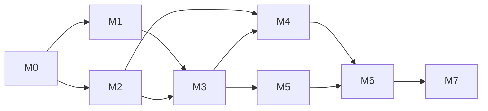

# Roadmap

Ordering principle: a **thin end-to-end slice first** (live data → signal → dashboard) so the app is
usable early, then deepen each layer. No calendar dates are promised before the M0 dependency spikes;
sizes are relative (S/M/L).

## Live status

| Milestone | Status | Evidence |
|---|---|---|
| P — Planning documents | ✅ Done, approved by owner 2026-10-19 | `docs/`, [decision record](DECISIONS_PENDING.md) |
| M0 — Foundations | 🔄 Code complete; **not formally accepted**: owner's Windows manual check + Binance spike pending | Core: CI 39351055547. API/dashboard/launcher (M0-T4, `ed0d5d7`): CI 39430972397, review approved after 1 blocking fix. Owner launched the app on Windows for the MVP-4 smoke test (2026-10-28) |
| M1 — Live tape (walking skeleton) | 🔄 Code complete (M1-T1 `d9a8890`, M1-T2 merged); **not formally accepted**: no accepted result of the 2-hour `scripts/verify_live.ps1` gate is recorded (local owner runs exist; the WHEA hardware investigation is open) | M1-T1: CI 39432193506; M1-T2: CI 39515178440, review fixes applied; `verify_live` duration check fixed (`7d615a4`, local) |
| M2 — Historical data + backtest core | ✅ **Formally accepted, limited scope** (owner S7, 2026-11-07T02:37:00Z, [D-22](DECISIONS_PENDING.md)): Binance Spot 1m, BTCUSDT/ETHUSDT/SOLUSDT/DOGEUSDT/XRPUSDT, 2022-01-01 → 2025-12-31, code at `9f908d9`, CI `42322235295` 7/7; all caveats and deferred items of [M2_ACCEPTANCE_RECORD](M2_ACCEPTANCE_RECORD.md) §4–§5 preserved; **not** M3 acceptance, any research or profitability claim, any other dataset, or holdout access. Code complete (importer, lake, simulator, statistics, runner). *The qualifiers (a)–(f) below are the record as it stood before S7 and are kept as history; "not formally accepted" there refers to that earlier state*: (a) *stale, corrected 2026-11-06:* the simulator restore property no longer fails — `tests/unit/sim/test_sim_property_regressions.py -k 13073`: 8 passed; the full property suite (`test_sim_property_regressions.py` + `test_paper_properties.py`): 79 passed, 0 failed, on this branch's HEAD (ancestors `904b84c`, `0435116`, `e87fe59`, `d1e280a`); a documented residual (≈0.05%, 3/6,000 random cases, absent an explicit `start_ms`) is unchanged and already pinned by its own test, not new; (b) canonical data covers 5 of the frozen Top 10 symbols (2022 → 2026-09; holdout sealed), the batches B01–B12 await acceptance, and USD-M/funding is not imported; (c) **canonical import defect C-1 repaired 2026-11-06 (D-17)**: the owner authorized and the tool executed one controlled additive promotion against the real canonical lake (op id `45d9e72abf9c43458370a0b0a7e9e647`, `COMPLETE`/`accepted: true`; SOL 2022-12 44,639→44,640, XRP 2025-04 43,199→43,200; exactly 4 canonical objects added, 0 modified/deleted, independently re-verified with a fresh `LakeReader` after the apply); old dataset pins are unchanged and still reproduce the original gap; see [DECISIONS_PENDING D-17](DECISIONS_PENDING.md) and [the D-17 devlog](devlog/2026-11-06-m2-d17-canonical-promotion.md); this is a repair of C-1 only, not B01–B12 (D-15, unaffected) and not formal M2 acceptance; (d) data policies ADR-0013/0014/0015 accepted in principle by the owner (D-09 … D-13, 2026-10-28); O-4 passed and D-12 is approved for implementation; E-1/E-1b (registry schema 2 + no-fill rule, sim-v1 / runner-v3) and E-3 (importer integrity safeguards) are implemented and integrated locally into `feat/mvp-4-dashboard` (merge `03c9158`, 2026-10-30; not pushed, not in `main`): implemented policy, not formal acceptance. E-2 is committed and integrated locally (`e973f86`; not pushed, not in `main`): its targeted regression and independent review passed (final verdict APPROVE WITH NOTES), some of its mutants ran on a prior code revision. O-7 ran once on `0c3f607` and the owner accepted its evidence with qualifications (D-18): that is not M2 acceptance, canonical promotion or unrestricted research use, and no statistical strategy validation is implied. Owner checks O-2, O-3 and O-4 passed (2026-10-28). **No backtest run recorded locally**; (e) **M2 global Causality Auditor review, 2026-11-06: CONDITIONAL PASS** — the gate's five literal items (canaries, golden trades, ledger property tests, window-parity, cross-OS hash) are independently verified green; the open conditions are governance/traceability only (this record; whether CI must re-run on the D-17 implementation commit `60f5ce4`, since CI `42275943593` covers only the prior commit `b1da844`), not a causality or data-safety defect; see the D-17 devlog above. *Update, publication:* those conditions are satisfied by the published commits `b24f41e` + `9f908d9` (local `60f5ce4`/`f18eb9f` never published, rebuilt to withhold sealed-holdout metadata) and CI `42322235295` (7/7 green, Ubuntu + Windows); the verdict itself stands as issued; (f) **all six gate items have evidence; the owner's S7 sign-off was then granted on 2026-11-07 (see the start of this row)**, with the limited scope (five Spot symbols, 2022-01 → 2025-12) and caveats in [M2_ACCEPTANCE_RECORD](M2_ACCEPTANCE_RECORD.md) | M2-T1 CI 39546228675 · M2-T2 CI 39472703030 · M2-T3 CI 39552397787 · M2-T4 CI 39596166216 · ms/µs archive fix: local `pytest tests` 1005 passed; not yet in CI. AP-1 bounded importer `7d615a4` (local). D-17: published `b24f41e` + `9f908d9` on `origin/task/m2-closure`, CI `42322235295` 7/7 green on `9f908d9` (cross-OS gate: both pinned-hash tests PASSED on both OS). Data audit: [acceptance matrix](M2_DATASET_ACCEPTANCE.md), [devlog 2026-10-27](devlog/2026-10-27-m2-handover-reconciliation.md), [devlog 2026-10-28](devlog/2026-10-28-m2-policy-design.md), [O-7 devlog](devlog/2026-10-30-m2-o7-qa-rerun.md), [D-17 devlog 2026-11-06](devlog/2026-11-06-m2-d17-canonical-promotion.md) |
| M3 — Paper trading + risk | 🔄 Engine merged (M3-T1); paper wired into the app, hardened, and fed by a REFERENCE strategy (MVP-2 to MVP-4, local); **not formally accepted**: the gate "recorded live session replays to an identical ledger hash" is not met (restart-equivalence defects, seeds 13073 / 465923499). Part B class 1 (journaled minute close) and its follow-up M3-PB.1 are in local checkpoint `0435116` on `task/m3-partb` (not pushed, not merged); the independent re-review of M3-PB.1 on `0435116` gave PASS / PASS (`reviewer`, `causality-auditor`, 0 blocking), so the M3-PB.1 implementation is accepted as a checkpoint; **full Part B is not accepted** ([brief](tasks/M3-PB.md), [devlog](devlog/2026-11-03-m3-partb-close-marks.md)). M3-PB.2 (local checkpoint, test harness only) makes the restore property never poll the restored service before the crash: 13073 / 124 and 465923499 / 162 then reproduce the uninterrupted journal and ledgers. Its review found blocking B-1 (the delayed-restart model was not production's). The B-1 remediation (tests only) checks delayed restarts through the production backfill path and was accepted by the independent re-review, which confirmed production limitation **P-1**: an entry can fill in a minute the downtime overlaps (for example 696831125 / 13 / 180,000; intrabar 32438366 / 129 / 24,837), so the delayed property is red at random. The re-review's shared blocker RR-B1 (the check missed fills in the minute the crash interrupted) is remediated, tests only; its closure review gave RR-B1 PASS and B-1 preservation PASS from both reviewers, so M3-PB.2 is a local implementation checkpoint (not pushed, not merged); the delayed property is not accepted ([M3-PB.2 devlog](devlog/2026-11-03-m3-pb2-restart-timeline-harness.md)). The owner decided P-1 on 2026-11-03 (D-19, D-20); its production fix (observation anchor, deferred reference warm-up) is implemented, and its independent review gave CONDITIONAL PASS / CONDITIONAL PASS (0 blocking), so it is a local checkpoint pending hardening (not pushed, not merged; [P-1 devlog](devlog/2026-11-03-m3-p1-observation-anchor.md)). The P-1 hardening (F-1 clock drift/step, F-2 and F-3 round-trip findings, N-1 and N-2 operator visibility) is a local checkpoint (not pushed, not merged); its independent review gave CONDITIONAL PASS / CONDITIONAL PASS (0 blocking; F-2, F-3, N-1, N-2 closed, F-1 conditionally closed), so P-1 is not unconditionally accepted ([hardening devlog](devlog/2026-11-03-m3-p1-hardening.md#independent-review-2026-11-03)). Follow-up (R-1/NB-2 producer tests, NB-1 assumption restated): local checkpoint `b4f8d01`, independent closure review PASS (R-1/NB-2 and NB-1 wording closed, 0 blocking; [closure review](devlog/2026-11-03-m3-p1-hardening.md#closure-review-2026-11-04)). NB-1 decided by the owner (D-21, 2026-11-04): option B (fresh clock round before the anchor, fail closed) with conditional acceptance of the residual risk, subject to the mitigation's tests and independent causality review; option B implemented, uncommitted; full non-live suite 1513 passed, independent causality review PASS (0 blocking, 5 non-blocking), so D-21's conditions are met; **NB-1 closed** by the owner (2026-11-04), residual risk explicitly accepted for the supervised paper-only MVP, local checkpoint, not pushed ([NB-1 devlog](devlog/2026-11-04-m3-p1-nb1-fresh-round.md)); the risk is reduced, not removed, and has no fixed error bound. M3-PB.3 startup backlog (bounded drain before each poll; historical 603669584 / 125 reproduced: 988.5 before, 990.0 after) implemented, uncommitted: focused 744 passed, causality-auditor PASS and reviewer APPROVE WITH NITS (0 blocking), checkpoint pending owner approval ([PB.3 devlog](devlog/2026-11-05-m3-pb3-startup-backlog.md)). Still open (a late bar of an exposed instrument is lost, exit timing changes); a minute released with no bar still blocks (owner OD-1: kept fail-closed, characterised, not eliminated; OD-2 decided: classified as SAFE_BLOCK, see below); closes made by a backfill are journaled by M3-PB.4 (existing `minute_closed` key; uncommitted; focused 554 passed; causality-auditor PASS, reviewer APPROVE WITH NITS, 0 blocking; [PB.4 devlog](devlog/2026-11-05-m3-pb4-backfill-close.md)); OD-2 restart outcomes RECOVERED / SAFE_BLOCK / FAIL implemented in the tests (uncommitted; focused 608 passed; 0 FAIL in the sweeps; delayed census 15 of 60 SAFE_BLOCK, which is a fail-closed stop, not availability; [OD-2 devlog](devlog/2026-11-05-m3-od2-recovery-outcomes.md)); M3-PB.5 (tests and a manual runbook only, uncommitted): the runtime backfill completeness check is covered by exposure (a flat instrument's gap does not block, an exposed one's refuses without journal writes or strategy calls, the pre-live-minute check; mutants on both checks caught; [runbook](RUNBOOK_PAPER_RESTART.md)); first real 30 min recording (strategy none) replays PASS but exercised no trading (0 observed bars; most likely the local clock 6886 ms off, fail-closed; [devlog](devlog/2026-11-06-m3-first-real-replay.md)), so that first recording alone left the replay gate open for nonempty ledgers; **a later one-hour recording (`strategy: bracket_reference`, 2026-11-06 10:54–11:54 local) was re-verified read-only from its artifacts: `verify-replay` PASS, 360 of 360 batches replayed, every ledger hash equal to the session-end evidence, 348 observed bars, 3 simulated benchmark entries (7 benchmark ledger postings including the deposit), baseline and shadow ledgers identical and holding only the deposit, `strategy_books_exercised: false`; so a nonempty-ledger real replay exists, for the benchmark book only, and strategy execution in a real session is still not shown** ([devlog 2026-11-06](devlog/2026-11-06-m3-first-real-replay.md) covers the first recording only); M3 availability and autonomous recovery not accepted. *Update 2026-11-06 (publication):* every M3 checkpoint listed above that was later committed (through `928aeb7`: `0435116` … `0ee0e4a` PB.3, `d1e280a` PB.4, `509f444` OD-2, `2a024c7` PB.5, `19ac13f`/`928aeb7` replay tooling) is an ancestor of the published `9f908d9`. That work is therefore pushed on `origin/task/m2-closure` (not merged into `main`), and its tests ran green on Ubuntu and Windows in CI `42322235295`. This supersedes the "uncommitted / not pushed / no CI or Linux run" wording above for those commits. It is CI evidence for the tests only; the live-session replay gate stays open | M3-T1 CI 39706561688, causality re-audit passed (28/28 mutations); M3-PB.1: local re-review PASS / PASS on `0435116`, no CI; M3-PB.2, its B-1 and RR-B1 remediations: local focused tests, scratch-copy mutants and local reviews only (closure review PASS / PASS on RR-B1 and B-1); MVP track below (focused local tests only) |
| M4 — Research protocol + first strategies | ⏳ Not started (M4-T1 brief exists). Prerequisites: M2 sign-off (S7, done 2026-11-07, limited scope); canonical parity (O-5, O-6; C-1 itself was repaired by D-17 on 2026-11-06); the B01–B12 decisions (D-15); Top 10 coverage; USD-M and funding if H4 needs them. E-1/E-1b/E-3 and E-2 are integrated locally and the O-7 QA re-runs are done; see the [validation plan](tasks/M2-remaining-validation-plan.md) | — |
| M5 — Claude signal agents | ⏳ | — |
| M6 — Performance analytics + evaluation export | ⏳ | — |
| M7 — Forward trial + hardening | ⏳ | — |

**Start stability (2026-11-09, owner-approved plan D-23; branch `feat/ingestion-bounded`, pushed, head `d649d95`; not merged):** the Start
ingestion is bounded (24 h catch-up, history on demand, one transaction per REST page, single writer thread joined on Stop, resumable
checkpoints, read-only `GET /api/ingestion`). CI (dispatched manually) green on `1dec031`, all 7 jobs on attempt 3, including the integration tests;
a Quant Equivalence Gate against the frozen previous implementation passes; red earlier attempts were pre-existing timing flakes also seen on `1acd38a`.
This is **not** milestone acceptance and does not claim the earlier unresponsiveness is fixed: that awaits the owner's manual
validation ([RUNBOOK_INGESTION](RUNBOOK_INGESTION.md), [devlog](devlog/2026-11-09-start-stability-bounded-ingestion.md)).
**Owner manual validation of the development profile: PASS (owner-reported, 2026-11-09, head `d649d95`):** BTCUSDT spot, `history: off`, 3 bars inserted, 0 errors, checkpoint ok, writer not stuck, Stop clean, `safe_to_close_store: true`, dashboard responsive. This covers the dev profile only: production-profile stability, a RUNNING paper session (O-1) and end-to-end MVP acceptance have **no evidence yet**.

**Autonomous MVP session (2026-11-09/10, branch `task/mvp-integration`, pushed under D-07, not merged):** reconciled status and plan in
[MVP_MASTER_PLAN](MVP_MASTER_PLAN.md), evidence in [MVP_VALIDATION_REPORT](MVP_VALIDATION_REPORT.md) (status **MVP FUNCTIONAL — VALIDATION
INCOMPLETE**), [MVP_USER_GUIDE](MVP_USER_GUIDE.md), [MVP_LIMITATIONS](MVP_LIMITATIONS.md). Added: read-only `GET /api/research/status` with an
explicit `NO_VALIDATED_STRATEGY` state, actionable paper-blocker hints, an anchored walk-forward driver (`tsclaude backtest walkforward`,
development segment only, synthetic tests only), an owner evidence script. Owner Stage B (production profile) clean from its artifacts; Stage C
(Paper O-1) loaded the 9-day history in about 33 s but observed no bar (PC clock 3.4 s off, since fixed) and ended with a PC restart. No gate
changes; none of this is M3/M4 acceptance.

**Closure audit (2026-11-10, independent, docs only):** [MVP_CLOSURE_HANDOFF](MVP_CLOSURE_HANDOFF.md). M3's literal gate has evidence for
both halves (three real sessions replayed identically on Linux; fault-injection tests green on both OS in CI `42754283876`, `42756815061`,
`42761802261`); **formal acceptance is still the owner's and is not given here**. The walk-forward driver must not be used on real data before
the two fixes in the handoff §4; the H1-v1 draft is not ready to freeze (§5). No gate changed.

**Track A closed in code, M4 infrastructure (2026-11-10):** WF-1 and WF-2 fixed, trial-registry run ids, README,
proposals D-A/D-B (open); independent review APPROVE WITH NOTES and causality audit CONDITIONAL PASS, findings fixed; CI
`42766333677` 7/7 on `04307f5` (later commits: see the devlog). M4 tooling with no policy decision: verified max-loss cache,
resumable walk-forward, dataset pins, `--prereg`, validity checks, trial-budget projection, coverage floor, final selection
pending governance, P&L-free feasibility count. Synthetic tests only; **no real-data walk-forward, no H1 run**; M4 not
started formally. Open owner decisions: D-A, D-B, D-C, D-D, D-E, D-F1, D-F2, D-G, D-H
([DECISIONS_PENDING](DECISIONS_PENDING.md)). Evidence: [devlog](devlog/2026-11-10-track-a-and-m4-walkforward-infrastructure.md).

### Shortest-safe-path MVP track (owner direction, 2026-10-27; local branches, not pushed)
A demonstrable local Windows app, strictly paper-only, built in small approved steps. Every step is **MVP
readiness only**: none of these items is M1–M4 acceptance, and none is evidence of strategy performance.
Results come from focused tests only and are provisional while the WHEA hardware investigation is open.

| Step | Status | Commit | Evidence |
|---|---|---|---|
| MVP-1: integration branch (AP-1 bounded importer, `verify_live` duration check, PARTIAL simulator property fix) | ✅ Committed locally | `7be73eb` (`integrate/mvp-1`) | [devlog 2026-10-27](devlog/2026-10-27.md), [sim property devlog](devlog/2026-10-27-sim-property-defects.md) |
| MVP-2: paper trading wired into the app, off by default | ✅ Committed locally | `6628a2e` | [devlog](devlog/2026-10-27-mvp2-paper-wiring.md) |
| MVP-2.1: paper runtime hardening (freshness labels, atomic snapshot, fail-closed audit log, subscription loss) | ✅ Committed locally | `11fd12e` | [devlog](devlog/2026-10-28-mvp21-paper-hardening.md) |
| MVP-3: live `bracket_reference` adapter (REFERENCE / NOT VALIDATED, CONFIRMED-only intents), 9-day startup history | ✅ Committed locally | `3f03b46` | [devlog](devlog/2026-10-28-mvp3-reference-adapter.md) |
| MVP-4: Paper and Backtests dashboard pages; read-only trade, rejection and warm-up details | ✅ Committed locally; owner Windows smoke test passed (disabled paper, empty backtests) | `7295082` (+ `27d4f52` M2 reconciliation docs) | [devlog](devlog/2026-10-28-mvp4-dashboard.md) |

Open limitations carried by the track:
- restart equivalence is not guaranteed;
- an unobserved live minute restarts the ~7.8-day reference warm-up;
- the real 9-day first start is unmeasured;
- RUNNING paper has not been checked in the real app;
- no backtest run exists.

**Current work:** E-1 (exchange-interruption registry and no simulated fills on zero-trade candles, `4e88ba0`; [E-1 devlog](devlog/2026-10-28-m2-e1-no-fill-and-interruptions.md)), E-1b (D-09A registry governance, D-10A observed/absent split, `5f623e9`; [E-1b devlog](devlog/2026-10-29-m2-e1b-registry-governance.md)) and E-3 (importer integrity, `e5a5e2e`; [E-3 devlog](devlog/2026-10-28-m2-e3-importer-integrity.md)) are integrated locally into `feat/mvp-4-dashboard` (merge `03c9158`, 2026-10-30; not pushed, not in `main`); [integration record](tasks/M2-E1-E3-integration-plan.md). Post-integration test batches passed except the pre-existing restore-equivalence property failure (seed 13073), reproduced identically on the pre- and post-integration code. This is implemented policy, not formal M2 acceptance. O-4 passed: [results](devlog/2026-10-28-o4-owner-capture.md). E-0 and E-4(a) committed (`e18f15a`, `c327bbd`). See the [approval package](devlog/2026-10-28-m2-approval-package.md). O-7 evidence is accepted with qualifications (D-18): [O-7 devlog](devlog/2026-10-30-m2-o7-qa-rerun.md); what remains is in the [validation plan](tasks/M2-remaining-validation-plan.md).
**Blockers:**
- **Owner decisions:**
  - the deferred decision D-15 (P-7) and batch promotion under D-17 (P-9; the C-1 repair is done);
  - merging and pushing the local MVP branches (D-07);
  - Part B (restart equivalence): the startup backlog (next), the empty
    minute,
    closes made by a backfill
    ([brief](tasks/M3-PB.md)).
- **Owner actions:**
  - the M1 2-hour run once the hardware allows;
  - a timed paper first start (O-1); a new paper session, now that E-1 is integrated (sim-v0 paper journals do not replay under sim-v1 and restore fails closed; no existing session was opened, migrated or reset).
- **Live Binance verification:** still needs the D-01 domain allowlist or a run on Windows.

## MVP reconciliation against the literal definition (2026-11-06)
- **Definition.** MVP = **M0–M5 plus the export part of M6** (see "Expected path" below). M7 (forward trial and
  hardening) is post-MVP.
- **Three kinds of evidence.** This table separates them so that no column counts as another:
  - a **formal gate**: the milestone's literal gate with owner acceptance;
  - **demonstrated**: shown working, with evidence, but not a gate;
  - **post-MVP**: outside the MVP definition.
- **CI.** CI `42322235295` (7/7 green, Ubuntu + Windows, on `9f908d9`) is the CI evidence for every committed item
  below and for the M2 acceptance. The later documentation-only HEAD `9cf9a11` is also 7/7 green on run
  `42326431882`, but only after one Windows test failed in the first attempt and passed on the re-run of that job;
  both facts stand, and the cause is not proven (see [D-22](DECISIONS_PENDING.md)).

| Milestone | Literal gate | Gate state | Demonstrated, not a gate | Missing for the gate |
|---|---|---|---|---|
| M0 | `pytest` + `pnpm test` green on both OS; launcher opens the shell; event-chain integrity test; spike findings recorded | evidence mostly present | CI 7/7 both OS incl. frontend; owner launched the app (2026-10-28); a real 30 min session received spot and USD-M public streams on the owner's network (2026-11-06) | owner Windows check recorded as acceptance; Binance spike findings written up (the 2026-11-06 session is candidate evidence, not yet recorded as the spike) |
| M1 | 2-hour live run with zero unexplained gaps; induced disconnect; hard kill and restart; replay E2E test | open | live tape and dashboard on real data; replay E2E test in CI | an accepted 2-hour `verify_live` run (blocked by the WHEA hardware investigation) |
| M2 | canaries, golden trades, ledger properties, window-parity, cross-OS hash; Causality Auditor sign-off | **accepted, limited scope (S7, 2026-11-07, D-22)** | Backtests page (empty: no real-data run) | nothing for the gate; caveats and deferred items stay ([record](M2_ACCEPTANCE_RECORD.md)) |
| M3 | a recorded live session replays to an identical ledger hash; fault injection (stale stream, risk-rule exception, crash mid-fill) blocks or recovers | open: fault-injection tests are green in CI but the fault-injection gate is not formally accepted; real replays PASS (a 30 min one with empty ledgers, a 1 h one with 348 observed bars and a nonempty benchmark ledger) | paper runtime, risk gate, three books, `verify-replay`, restart runbook; for Target A the owner accepts a real observed-bar replay with a nonempty benchmark ledger and matching hashes as evidence of the live-to-replay pipeline (2026-11-06) | acceptance of the literal fault-injection gate; strategy and risk execution shown by deterministic tests (Target A test implemented locally 2026-11-07, uncommitted, no CI: [devlog](devlog/2026-11-07-target-a-e2e-test.md)); independent review of the session evidence |
| M4 | committed preregistrations, graded reports with CIs and trial counts, holdout unlock events, ≥ 1 strategy live (grade ≥ C, labeled) | not started | preregistration, trials, statistics and runner code; one REFERENCE strategy (not validated) | data prerequisites (see the M4 row), then the research itself |
| M5 | all agent paths tested with a mocked client; app fully working with agents `off`; measured cost and latency | not started (no `agents/` package) | none | the whole milestone |
| M6 (export only) | export validates against schema; a scorer reproduces dashboard metrics from the export alone | not started | Evaluation export page is an empty state | JSONL export, schemas, scorer |
| M7 | ≥ 30 days of prospective operation, protocol frozen | post-MVP | — | — |

- **Post-MVP enhancements:** the analytics and agent-value parts of M6; M7; and the M7 backlog (Discord, mini-PC,
  point-in-time universe, 4h swing, order-book capture).
- **Technical demo versus MVP.** An initial technical end-to-end demonstration runs the chain live public data →
  REFERENCE signal → risk gate → paper ledgers → dashboard → replay verification. It is **not** the MVP: it needs
  no M4, M5 or M6 work, and it proves no strategy. Its evidence coincides with the missing M3 replay evidence, so
  one clock-synced, supervised session serves both. The delivery targets (technical demonstration, quantitative
  research, full roadmap), the two-roadmap view and planning ranges are a **proposal** in
  [MVP_DELIVERY_TARGETS_PROPOSAL](MVP_DELIVERY_TARGETS_PROPOSAL.md); this roadmap's definitions are unchanged.

## Dependency graph

M1 and M2 can proceed in parallel after M0 (different owners: Data/Platform vs Quant/Simulation).

## Milestones

### M0 — Foundations (S)
Scaffold `pyproject` + `uv`, frontend toolchain, CI (Windows + Ubuntu), lint/type/test gates,
`contracts/` v0 (events, bars, signal record, provenance), SQLite event store with hash chain,
structured logging, Windows launcher, dashboard shell with status bar and empty states, devlog.
Spikes: (a) Windows asyncio + websockets reconnect behaviour; (b) archive file coverage on
`data.binance.vision`; (c) Binance reachability from the owner's network for spot and futures.
**Gate:** `uv run pytest` + `pnpm test` green on both OSes in CI; `TradingSystemClaude.cmd` opens the
shell on Windows; event chain integrity test passes; spike findings recorded.

### M1 — Live tape (M) — *first visible result*
Spot + futures ingestors (1m klines, bookTicker, markPrice) for 3 symbols, bar builder with watermark,
REST recovery, freshness/gap monitor, session tracking, connection recycling; Start/Stop; Markets and
Health pages on real data; in-app notifications; one **clearly labeled demo detector** (not a
strategy) emitting `WATCH` events end-to-end into the Signals inbox.
**Gate:** 2-hour live run on Windows with zero unexplained gaps; induced disconnect → gap detected and
recovered; hard kill → restart shows the unobserved interval and recovers bars; replay-mode E2E test
passes.

### M2 — Historical data + backtest core (L)
Archive importer with checksum verification and dataset IDs; Parquet lake + DuckDB catalog; data QA;
derived timeframes + consistency check; simulator with `HistoricalClock`, fill model, costs,
intrabar resolution, ledger, metrics, run manifests; Backtests pages.
**Gate:** look-ahead canaries, golden trades, ledger property tests, window-parity test, cross-OS
reproducibility hash — all green; Causality Auditor sign-off.

### M3 — Paper trading + risk (M)
`LiveClock`, paper books (baseline + benchmark), risk engine (fail-closed), kill switch, restart
resolution over backfill, Paper pages.
**Gate:** recorded live session replays to an identical ledger hash; fault-injection tests (stale
stream, exception in risk rule, crash mid-fill) all block or recover correctly.

### M4 — Research protocol + first strategies (L)
Pre-registration tooling, holdout guard, walk-forward, bootstrap + deflated Sharpe, random-entry
controls, evidence grades, H1–H3 (H4 if futures data permits), Research pages; promotion of frozen
strategy versions to the live scanner (Early Watch + Confirmed Entry).
**Gate:** each hypothesis has a committed preregistration and a graded report with CIs and trial
counts; holdout unlock events recorded; at least one strategy runs live (any grade ≥ C, labeled).

### M5 — Claude signal agents (M)
Evidence packets with masking, Analyst + Skeptic prompts, JSON validation, deterministic synthesis,
cache, budget, circuit breaker, `agent_gated` book, Agent tab, cost page.
**Gate:** all agent paths tested with a mocked client (valid, invalid, timeout, over-budget, API down);
app fully functional with mode `off`; with a key: measured cost/latency per signal on live signals.

### M6 — Performance analytics + evaluation export (M)
Analytics by strategy/asset/regime/hour, agent-value page, JSONL export + schemas, daily chain-head
evidence commits, draft protocol finalized with the other team.
**Gate:** export validates against schema; a scorer reproduces dashboard metrics from the export alone.

### M7 — Forward trial + hardening (ongoing)
Protocol frozen; ≥ 30 days of prospective operation; weekly API-drift check; performance tuning;
optional packaging (PyInstaller/tray). Post-MVP backlog: Discord adapter, mini-PC deployment,
point-in-time universe, 4h swing strategies, order-book research data capture.

## Expected path to the first working local MVP

1. **M0 + M1** → you can open the app on Windows, start monitoring and watch real Binance data, health
   and demo `WATCH` events flowing into the dashboard, then stop and restart with visible recovery.
2. **M2 + M3** → backtests run from the dashboard; the demo detector is replaced by paper trading on
   the same simulator with fail-closed risk.
3. **M4** → real pre-registered strategies feed Early Watch / Confirmed Entry with evidence grades.
4. **M5** → optional Claude review on confirmed signals with cost tracking.
MVP = end of M5 plus the export part of M6.

## MVP acceptance criteria

Each criterion needs linked evidence (test run, recording, report) before it is ticked.

- [ ] AC-01 Fresh Windows machine: setup in ≤ 3 documented commands; app starts via launcher.
- [ ] AC-02 Start/Stop monitoring works; status bar always reflects the real backend state.
- [ ] AC-03 Live spot and futures data for the configured universe, with freshness and provenance shown.
- [ ] AC-04 Disconnect, 24h recycle, sleep/hard-kill: gaps detected, recovered where possible, unrecoverable ones visible; no live signals during downtime.
- [ ] AC-05 Archive import verified by checksums; datasets content-addressed.
- [ ] AC-06 Backtest run from the UI is reproducible from its manifest (identical metrics hash).
- [ ] AC-07 Look-ahead canaries, golden trades, window-parity and replay-parity suites pass in CI.
- [ ] AC-08 ≥ 1 pre-registered strategy validated through walk-forward + holdout with a graded report.
- [ ] AC-09 Scanner emits Early Watch and Confirmed Entry with all REQ-SIG-03 fields and immutable IDs.
- [ ] AC-10 Paper trading applies fees, slippage, SL/TP and risk limits; state survives restart.
- [ ] AC-11 Stale data, risk-rule exceptions and limit breaches block entries (fault-injection tests).
- [ ] AC-12 Agent mode `off` and "API unavailable" leave every other feature working.
- [ ] AC-13 With agents on: reviews visible with evidence references; cost and latency recorded; budget enforced.
- [ ] AC-14 No value in the UI lacks a provenance badge; demo data impossible while monitoring.
- [ ] AC-15 Export of signals/transitions/fills/coverage validates against published schemas.
- [ ] AC-16 Dev metrics and devlog maintained for every task.
