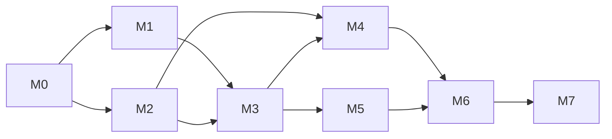

# Roadmap

Ordering principle: a **thin end-to-end slice first** (live data → signal → dashboard) so the app is
usable early, then deepen each layer. No calendar dates are promised before the M0 dependency spikes;
sizes are relative (S/M/L).

## Live status

| Milestone | Status | Evidence |
|---|---|---|
| P — Planning documents | ✅ Done, approved by owner 2026-10-19 | `docs/`, [decision record](DECISIONS_PENDING.md) |
| M0 — Foundations | 🔄 Code complete; owner's Windows manual check + Binance spike pending | Core: CI 39351055547. API/dashboard/launcher (M0-T4, `ed0d5d7`): CI 39430972397, review approved after 1 blocking fix |
| M1 — Live tape (walking skeleton) | 🔄 Code complete (M1-T1 `d9a8890`, M1-T2 merged); **gate pending: owner's 2-hour `scripts/verify_live.ps1` run on Windows** | M1-T1: CI 39432193506; M1-T2: CI 39515178440, review fixes applied |
| M2 — Historical data + backtest core | 🔄 Simulator, statistics and importer merged; backtest runner (M2-T4) in progress | M2-T2 CI 39472703030 · M2-T3 CI 39552397787 · M2-T1 CI 39546228675 |
| M3 — Paper trading + risk | ⏳ | — |
| M4 — Research protocol + first strategies | ⏳ | — |
| M5 — Claude signal agents | ⏳ | — |
| M6 — Performance analytics + evaluation export | ⏳ | — |
| M7 — Forward trial + hardening | ⏳ | — |

**Current work:** M0-T4 (API/dashboard), M1-T1 (Binance ingestion), M2-T2 (simulator core),
M2-T3 (statistics for certified win rates) — in parallel, each in its own branch. **Blockers:** none for M0; live Binance verification needs the
D-01 domain allowlist (owner action) or a run of the verification script on Windows.

## Dependency graph

M1 and M2 can proceed in parallel after M0 (different owners: Data/Platform vs Quant/Simulation).

## Milestones

### M0 — Foundations (S)
Scaffold `pyproject` + `uv`, frontend toolchain, CI (Windows + Ubuntu), lint/type/test gates,
`contracts/` v0 (events, bars, signal record, provenance), SQLite event store with hash chain,
structured logging, Windows launcher, dashboard shell with status bar and empty states, devlog.
Spikes: (a) Windows asyncio + websockets reconnect behaviour; (b) archive file coverage on
`data.binance.vision`; (c) Binance reachability from the owner's network for spot and futures.
**Gate:** `uv run pytest` + `pnpm test` green on both OSes in CI; `TradingSystemClaude.cmd` opens the
shell on Windows; event chain integrity test passes; spike findings recorded.

### M1 — Live tape (M) — *first visible result*
Spot + futures ingestors (1m klines, bookTicker, markPrice) for 3 symbols, bar builder with watermark,
REST recovery, freshness/gap monitor, session tracking, connection recycling; Start/Stop; Markets and
Health pages on real data; in-app notifications; one **clearly labeled demo detector** (not a
strategy) emitting `WATCH` events end-to-end into the Signals inbox.
**Gate:** 2-hour live run on Windows with zero unexplained gaps; induced disconnect → gap detected and
recovered; hard kill → restart shows the unobserved interval and recovers bars; replay-mode E2E test
passes.

### M2 — Historical data + backtest core (L)
Archive importer with checksum verification and dataset IDs; Parquet lake + DuckDB catalog; data QA;
derived timeframes + consistency check; simulator with `HistoricalClock`, fill model, costs,
intrabar resolution, ledger, metrics, run manifests; Backtests pages.
**Gate:** look-ahead canaries, golden trades, ledger property tests, window-parity test, cross-OS
reproducibility hash — all green; Causality Auditor sign-off.

### M3 — Paper trading + risk (M)
`LiveClock`, paper books (baseline + benchmark), risk engine (fail-closed), kill switch, restart
resolution over backfill, Paper pages.
**Gate:** recorded live session replays to an identical ledger hash; fault-injection tests (stale
stream, exception in risk rule, crash mid-fill) all block or recover correctly.

### M4 — Research protocol + first strategies (L)
Pre-registration tooling, holdout guard, walk-forward, bootstrap + deflated Sharpe, random-entry
controls, evidence grades, H1–H3 (H4 if futures data permits), Research pages; promotion of frozen
strategy versions to the live scanner (Early Watch + Confirmed Entry).
**Gate:** each hypothesis has a committed preregistration and a graded report with CIs and trial
counts; holdout unlock events recorded; at least one strategy runs live (any grade ≥ C, labeled).

### M5 — Claude signal agents (M)
Evidence packets with masking, Analyst + Skeptic prompts, JSON validation, deterministic synthesis,
cache, budget, circuit breaker, `agent_gated` book, Agent tab, cost page.
**Gate:** all agent paths tested with a mocked client (valid, invalid, timeout, over-budget, API down);
app fully functional with mode `off`; with a key: measured cost/latency per signal on live signals.

### M6 — Performance analytics + evaluation export (M)
Analytics by strategy/asset/regime/hour, agent-value page, JSONL export + schemas, daily chain-head
evidence commits, draft protocol finalized with the other team.
**Gate:** export validates against schema; a scorer reproduces dashboard metrics from the export alone.

### M7 — Forward trial + hardening (ongoing)
Protocol frozen; ≥ 30 days of prospective operation; weekly API-drift check; performance tuning;
optional packaging (PyInstaller/tray). Post-MVP backlog: Discord adapter, mini-PC deployment,
point-in-time universe, 4h swing strategies, order-book research data capture.

## Expected path to the first working local MVP

1. **M0 + M1** → you can open the app on Windows, start monitoring and watch real Binance data, health
   and demo `WATCH` events flowing into the dashboard, then stop and restart with visible recovery.
2. **M2 + M3** → backtests run from the dashboard; the demo detector is replaced by paper trading on
   the same simulator with fail-closed risk.
3. **M4** → real pre-registered strategies feed Early Watch / Confirmed Entry with evidence grades.
4. **M5** → optional Claude review on confirmed signals with cost tracking.
MVP = end of M5 plus the export part of M6.

## MVP acceptance criteria

Each criterion needs linked evidence (test run, recording, report) before it is ticked.

- [ ] AC-01 Fresh Windows machine: setup in ≤ 3 documented commands; app starts via launcher.
- [ ] AC-02 Start/Stop monitoring works; status bar always reflects the real backend state.
- [ ] AC-03 Live spot and futures data for the configured universe, with freshness and provenance shown.
- [ ] AC-04 Disconnect, 24h recycle, sleep/hard-kill: gaps detected, recovered where possible, unrecoverable ones visible; no live signals during downtime.
- [ ] AC-05 Archive import verified by checksums; datasets content-addressed.
- [ ] AC-06 Backtest run from the UI is reproducible from its manifest (identical metrics hash).
- [ ] AC-07 Look-ahead canaries, golden trades, window-parity and replay-parity suites pass in CI.
- [ ] AC-08 ≥ 1 pre-registered strategy validated through walk-forward + holdout with a graded report.
- [ ] AC-09 Scanner emits Early Watch and Confirmed Entry with all REQ-SIG-03 fields and immutable IDs.
- [ ] AC-10 Paper trading applies fees, slippage, SL/TP and risk limits; state survives restart.
- [ ] AC-11 Stale data, risk-rule exceptions and limit breaches block entries (fault-injection tests).
- [ ] AC-12 Agent mode `off` and "API unavailable" leave every other feature working.
- [ ] AC-13 With agents on: reviews visible with evidence references; cost and latency recorded; budget enforced.
- [ ] AC-14 No value in the UI lacks a provenance badge; demo data impossible while monitoring.
- [ ] AC-15 Export of signals/transitions/fills/coverage validates against published schemas.
- [ ] AC-16 Dev metrics and devlog maintained for every task.
