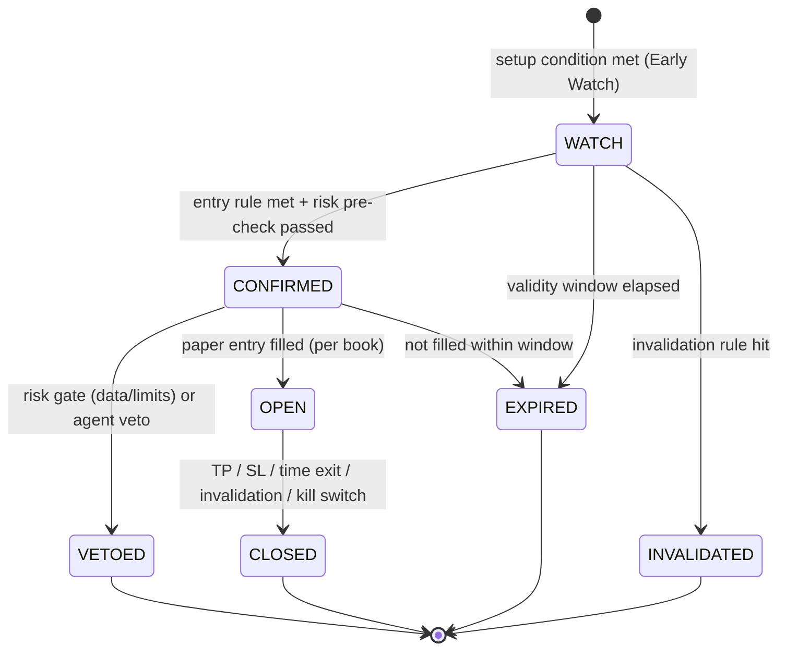
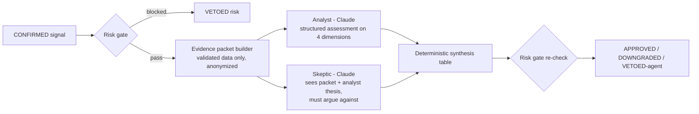

# Signals and Claude Signal-Evaluation Agents

## 1. Signal lifecycle

- **Early Watch** = "this market deserves attention"; it is explicitly *not* an entry recommendation
  and carries no position.
- **Confirmed Entry** = the strategy's pre-registered entry rule fired **and** the deterministic risk
  pre-check passed. It can still be vetoed (risk re-check, agent veto).
- Every transition is an append-only event; the current state is a projection. Vetoed and expired
  signals are kept — for the outcome analysis, a vetoed signal's *hypothetical* outcome is still
  computed (shadow outcome), which is how veto quality is measured.
- A `run_mode` field is `LIVE` (created during an observed session), `REPLAY` or `BACKTEST`. Only `LIVE`
  signals enter the forward trial and A/B evaluation.

## 2. Signal record (REQ-SIG-03)

| Master-prompt field | Record field(s) |
|---|---|
| Unique signal ID | `signal_id` (ULID: time-sortable) |
| Symbol and market type | `symbol`, `market` (`spot` / `usdm`) |
| Strategy and version | `strategy_id`, `strategy_version`, `params_hash`, `prereg_id` |
| Direction | `side` (`long` / `short`) |
| Timestamp | `decision_time` (bar close), `created_at` (persisted), `latency_ms` |
| Market data snapshot reference | `snapshot_id` → stored evidence packet (bars window hash, features, book_top, data health) |
| Entry conditions | `entry_conditions[]` (machine-readable predicates + values at decision time) |
| Entry price / executable rule | `entry_rule` (`market_next_open` / `limit@price` / `stop@price`), `ref_price` |
| Stop-loss | `stop_price`, `stop_basis` (e.g. 1.5×ATR below range low) |
| Take-profit / exit policy | `take_profit_price` and/or `exit_policy` (trailing, time-exit after N bars) |
| Risk/reward estimate | `rr_gross`, `rr_net` (after modeled costs), `est_cost_bps` |
| Signal rationale | `rationale` (templated from conditions, deterministic text) |
| Relevant market conditions | `regime` (trend/range, vol percentile), `spread_bps`, `funding` |
| Agent assessments | `agent_review_id` → review record (or `NOT_REQUESTED` / `AI_UNAVAILABLE` / `BUDGET_EXHAUSTED`) |
| Lifecycle status | `status` + transitions |
| Final simulated outcome | per book: `outcome` (TP/SL/TIME/…), `pnl_r`, `pnl_net`, `mae`, `mfe`, `ambiguous_bar` |

## 3. Signal-evaluation agents — design

The goal is analytical value at bounded cost with reproducible decisions. Six independent LLM agents
per signal would multiply cost and latency while all being the same model — their "consensus" is not
statistical independence. The design therefore uses **two LLM roles plus deterministic synthesis**.

| Role | Covers (Master Prompt §7) | Output (JSON schema) |
|---|---|---|
| Packet builder (code) | — | Facts only: bars window, computed features, regime labels, costs, spread, funding, data-health flags, risk state, strategy description. Prices normalized (relative to entry, in ATR units), symbol and calendar dates masked. |
| **Analyst** (Claude) | 1 regime/context, 2 technical validation, 3 volatility/liquidity, 4 risk | Per dimension: `score ∈ {-2..+2}`, `evidence_refs[]` (must cite packet field IDs), `concerns[]`; overall `stance` |
| **Skeptic** (Claude) | 5 adversarial analysis | `objections[]` each with `severity ∈ {minor, material, fatal}` and `evidence_refs[]` |
| Synthesis (code) | 6 final decision | Rule table → `APPROVED`, `DOWNGRADED` (priority lowered, stays in baseline book only), `VETOED_AGENT` |

Rules that keep agents honest:
- Agents may **only** approve, downgrade or veto. They cannot change entry/SL/TP, size, or approve a
  risk-blocked signal. The risk gate runs again after synthesis.
- Every claim must reference packet fields; outputs referencing non-existent fields or containing
  numbers not present in the packet are rejected by the validator (`AGENT_OUTPUT_INVALID` → treated as
  no review, never as approval).
- **Training-data contamination guard:** Claude may have seen historical price action up to its
  training cutoff. Packets therefore mask symbol, dates and absolute price levels, and *agent ablation
  results are only credited on signals after the model's training cutoff* — i.e. the forward trial.
  Historical "agent backtests" are reported as indicative only.
- Prompts are versioned files; packets, prompts and responses are stored and keyed by
  `hash(packet, prompt_version, model)`. Re-displaying a review never re-calls the API; a deliberate
  re-evaluation creates a new review record.

## 4. Modes, budget and failure handling (REQ-AGT-03, REQ-AGT-06)

| Mode | Behaviour |
|---|---|
| `off` (default until a key and budget are configured) | Deterministic only. UI shows `NOT_REQUESTED`. |
| `confirmed` | Review every `CONFIRMED` signal that passes the risk gate, within the daily budget. |
| `research` | Offline: review historical/replay signals via the Batch API (50 % cheaper), labeled indicative. |

- Per-call timeout (default 30 s), one bounded retry, circuit breaker after N consecutive failures.
- If the API is unavailable, over budget or times out, the signal proceeds in the `baseline` book
  only and is labeled `AI_UNAVAILABLE` / `BUDGET_EXHAUSTED`. The `agent_gated` book does **not** take it
  (it has no review), and that is counted in coverage statistics.
- A `cost_ledger` event records model, input/output/cached tokens, cost estimate and latency per call.

## 5. Cost estimate (API list prices verified 2026-10-19)

Assumptions: Analyst ≈ 5,000 input / 700 output tokens; Skeptic ≈ 5,500 / 500; no caching credit.

| Model | Price (input / output per MTok) | ≈ Cost per reviewed signal | At 20 reviews/day (≈ per month) |
|---|---|---|---|
| Claude Haiku 5.5 | $0.10 / $0.50 | ≈ $0.002 | ≈ $1 |
| Claude Sonnet 5.5 | $2 / $10 | ≈ $0.03 | ≈ $20 |
| Claude Opus 5.5 | $4 / $20 | ≈ $0.07 | ≈ $40 |

Prompt caching of the static instructions reduces input cost further; Batch API halves research-mode
cost. These are planning estimates — the app measures real cost per signal. Proposed default:
Sonnet 5.5 for both roles, daily cap **$1** (decision D-03). API usage is billed separately from any
Claude subscription and needs an Anthropic API key.

## 6. How agent value is judged (REQ-AGT-07)

Pre-registered comparison over the forward trial: `agent_gated` vs `baseline` books (net expectancy
per trade, drawdown, and veto precision = share of vetoed signals whose shadow outcome was a loss),
with bootstrap CIs, plus cost per signal and added latency. With few confirmed signals per day the
comparison may stay inconclusive for a long time; the report will say so rather than declare value.
